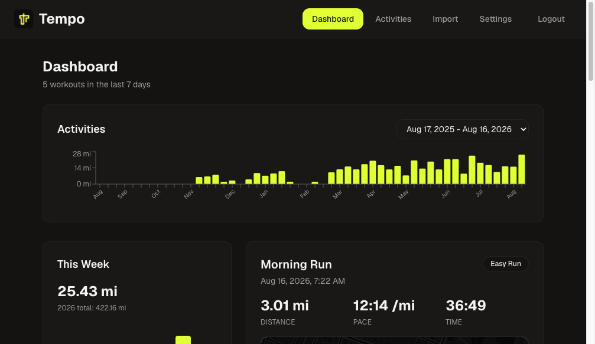
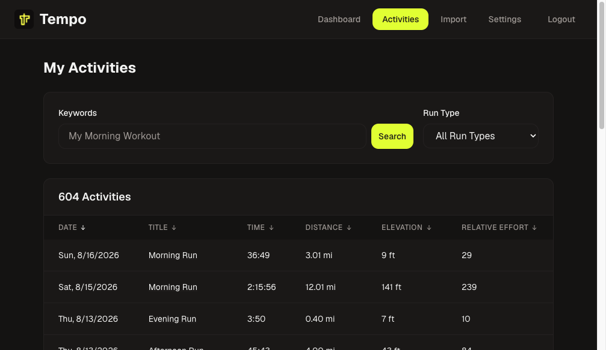

# Tempo - Self-Hostable Running Tracker

> A privacy-first, self-hosted Strava alternative. Import GPX, FIT, and CSV files from Garmin, Apple Watch, Strava, and more. Keep all your data local—no subscriptions, no cloud required.


[](https://discord.gg/9Svd99npyj)

**[View Full Documentation](https://trevordavies095.github.io/tempo/)** - Complete guides for installation, configuration, usage, deployment, and more.

**[Tempo on the App Store](https://apps.apple.com/us/app/tempo-self-hosted-running/id6763753229)** - Daily-driver iOS app for your self-hosted server, including units, shoes and a read-only thresholds view. The WebUI is the command center (bulk import, threshold editing, shoe deletion, the full Workout overview).

## Screenshots


*Dashboard — weekly recap, relative effort, and recent workouts*


*Activities list — search, filters, and sortable columns*

## Quick Start

Get Tempo running in minutes with Docker Compose:

```bash
# Clone the repository
git clone https://github.com/trevordavies095/tempo.git
cd tempo

# Start all services
docker compose up -d
```

Access the application at:
- **Frontend**: http://localhost:3000
- **API**: http://localhost:5001

That's it! The database migrations run automatically on first startup. For detailed setup instructions, authentication, and configuration, see the [full documentation](https://trevordavies095.github.io/tempo/).

## Features

- **First-run onboarding** - Guided setup after registration (optional Tempo restore, essentials, optional Strava)
- **Multi-Format Support** - Import GPX and FIT (.fit, .fit.gz) files from Garmin, Apple Watch, and other devices, or a whole Strava export ZIP (activities.csv + activity files)
- **Workout Analytics** - Track distance, pace, elevation, splits, and time series data
- **Workout Overview** - Map, splits, and HR/pace/elevation/cadence/power charts sharing one Highlight
- **Appearance** - System, Dark, or Light on the command center (this browser only)
- **Interactive Maps** - Themed route maps (dark/light tiles) with tokenized polylines
- **Media Support** - Attach photos and videos to workouts
- **Weather Data** - Automatic weather conditions for each workout
- **Bulk Import** - Import a Strava export ZIP as a background job (onboarding or Settings → Migrate / restore; up to 500MB)
- **Heart Rate Zones** - Calculate zones using Age-based, Karvonen, or Custom methods
- **Relative Effort** - Automatic calculation of workout intensity based on heart rate zones
- **Best Efforts** - Track your fastest times for standard distances (400m to Marathon) from any segment within workouts
- **Shoe Tracking** - Track mileage on your running shoes and know when to replace them
- **Workout Editing** - Crop/trim workouts and edit activity names
- **Statistics Dashboards** - Weekly and yearly statistics with relative effort tracking
- **Unit Preferences** - Switch between metric and imperial units
- **100% Local** - All data stays on your machine, no cloud sync required

## Tech Stack

- **Frontend**: Next.js 16, React 19, TypeScript, Tailwind CSS, Tabler Icons
- **Backend**: ASP.NET Core (.NET 10) Minimal APIs
- **Database**: PostgreSQL 16
- **State Management**: TanStack Query

## Documentation

**For developers and agents:**

- **HTTP contract:** [docs/openapi.json](docs/openapi.json) is the canonical, generated contract (CI fails when it drifts). The [API Reference](docs/developers/api-reference.md) covers authentication, the route index, and non-obvious behavior.
- **API keys (CLI and automation):** Generate a key under **Settings → Account → API key**, then send `Authorization: Bearer tmp_…`. The [API keys walkthrough](docs/developers/api-reference.md#api-keys-cli-and-automation) covers what a key can do, curl examples, and rotation.
- **Domain vocabulary:** [CONTEXT.md](CONTEXT.md).
- **Local development, tests, and regenerating openapi.json:** [Development Setup](docs/developers/setup.md) and [Testing](docs/developers/testing.md#openapi-drift-check).

Comprehensive documentation is available at **[https://trevordavies095.github.io/tempo/](https://trevordavies095.github.io/tempo/)**:

- **[Getting Started](https://trevordavies095.github.io/tempo/getting-started/)** - Installation, quick start, and configuration guides
- **[User Guide](https://trevordavies095.github.io/tempo/user-guide/)** - Importing workouts, viewing analytics, managing media, and settings
- **[Developer Documentation](https://trevordavies095.github.io/tempo/developers/)** - Architecture, local development setup, API reference, and database schema
- **[Deployment](https://trevordavies095.github.io/tempo/deployment/)** - Production deployment, security best practices, and backup/restore procedures
- **[Troubleshooting](https://trevordavies095.github.io/tempo/troubleshooting/)** - Common issues, solutions, and frequently asked questions

## Support

- **Discord**: Join our community on [Discord](https://discord.gg/9Svd99npyj) for support and discussions
- **Issues**: Report bugs or request features on [GitHub Issues](https://github.com/trevordavies095/tempo/issues)
- **Changelog**: See [CHANGELOG.md](CHANGELOG.md) for version history and updates

## License

MIT License - see LICENSE file for details
