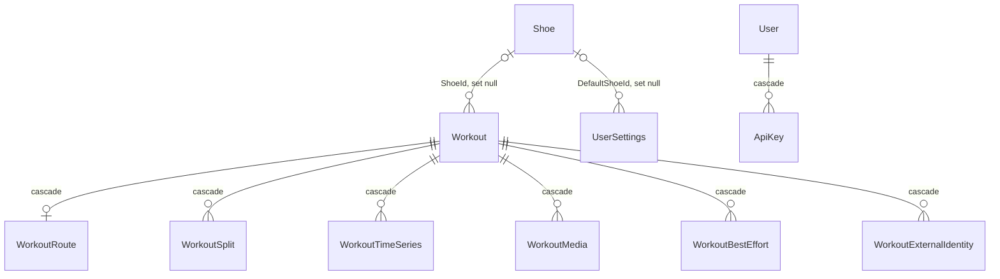

# Database Schema

What lives in PostgreSQL 16, how the schema changes, and how upgrade backfills fill derived data on existing libraries.

**Source of truth.** This page summarises; the code decides. When they disagree, trust:

- `api/Data/TempoDbContext.cs`: `DbSet`s, relationships, delete rules, indexes, check constraints
- `api/Models/*.cs`: columns, max lengths, column types, per-property comments
- `api/Migrations/TempoDbContextModelSnapshot.cs`: the schema EF believes exists (types as Npgsql maps them)
- `api/Migrations/*.cs`: raw-SQL objects the model does not describe (see [Objects outside the model](#objects-outside-the-model))

Domain terms (elapsed / timer / moving time, device lap, external identity) are defined in `CONTEXT.md`.

## Storage approach

- Core stats in typed columns for filtering and sorting; raw source payloads in `jsonb` for reprocessing.
- The original uploaded file is kept in `Workouts.RawFileData` (`bytea`) with `RawFileName` / `RawFileType`, so backfills can reparse it.
- Media and staged import archives live on the filesystem; the database holds paths and metadata only.
- Timestamps are `timestamp with time zone`, written as UTC.
- No table has a FK to `Users`: an instance is one athlete. `Users` exists for login and API keys.

## Entity relationships



Standalone (no FKs): `ImportJob`, `IntervalsIcuConnection`, `CompletedBackfill`.

Deleting a Workout cascades to every child table. Deleting a Shoe nulls `Workouts.ShoeId` and `UserSettings.DefaultShoeId`. Deleting a User cascades to its API keys.

## Entities

Table names are the `DbSet` names in `TempoDbContext`.

### Workout (`Workouts`)

One recorded run. PK `Id` (uuid).

Columns whose meaning is not obvious from the name:

| Column | Meaning |
| --- | --- |
| `DurationS` | **Elapsed time**: wall clock start to finish, pauses included. Used by duplicate detection. |
| `TimerTimeS` | **Timer time**: FIT `total_timer_time`, device running, pauses excluded. Null when the source has none. |
| `MovingTimeS` | **Moving time**: by speed threshold, when the source provides it. Not timer time. |
| `AvgPaceS` | Seconds per km, regardless of unit preference. |
| `ElevGainM`, `ElevLossM`, `MinElevM`, `MaxElevM` | Elevation in metres (note the `Elev` prefix). |
| `AvgCadenceRpm`, `MaxCadenceRpm` | Steps/min, both feet. The `Rpm` suffix is historical. |
| `Rpe` | Rate of Perceived Exertion 1–10. Athlete-set, or from FIT `workout_rpe` when null. Not Relative Effort. |
| `RelativeEffort` | Integer score from HR zones. |
| `ZoneSecondsZ1`…`ZoneSecondsZ5` | Whole seconds in each HR zone, computed with the zones in effect at the time. Null when there is no HR series. |
| `ZoneSecondsComputedAt` | When zone seconds were last computed (stamped even when the result is null). Null = not yet; the zone-seconds backfill picks it up. |
| `BestEffortsComputedAt` | Same idea for `WorkoutBestEfforts` rows. |
| `SplitHeartRateBackfill` | Split-HR backfill cursor; only value written is `no_overlap`. Not a metric. |
| `Source` | Ingest provenance (`gpx_import`, `fit_import`, `strava_import`, `healthkit`). Not the external-identity source. |
| `HealthKitUuid` | `HKWorkout.uuid` from tempo-ios; null for file imports. |
| `Weather` | `jsonb`: Open-Meteo response plus any device/Strava weather. |
| `RawGpxData`, `RawFitData`, `RawStravaData`, `RawHealthKitData` | `jsonb` raw payloads. Several backfills also write idempotency markers into `RawFitData` (see [Backfills](#upgrade-backfills)). |

Other columns: `StartedAt`, `DistanceM`, speed (`MaxSpeedMps`, `AvgSpeedMps`), HR (`Min/Avg/MaxHeartRateBpm`, `smallint`), power (`Avg/MaxPowerWatts`), `Calories`, `Name`, `RunType`, `Notes`, `Device`, `ShoeId`, `CreatedAt`.

`[JsonIgnore]` on the zone-seconds columns, both `*ComputedAt` stamps and `SplitHeartRateBackfill` keeps them out of API JSON and the Tempo ZIP export.

Indexes:

- `StartedAt`; `Source`; `RunType`; `ShoeId`
- `(StartedAt, DistanceM, DurationS)`: duplicate detection
- `HealthKitUuid` unique (multiple NULLs allowed)
- GIN on `RawGpxData`, `RawFitData`, `RawStravaData`, `RawHealthKitData`, `Weather`

### WorkoutRoute (`WorkoutRoutes`)

0..1 per Workout. PK `Id`; `WorkoutId` has a unique index.

- `RouteGeoJson` (`jsonb`, required): full GeoJSON LineString.
- `PreviewGeoJson` (`jsonb`, nullable): Douglas-Peucker simplification (≤ 100 points). Null = not computed yet; `[]` = sentinel for empty or unparseable source geometry.

### WorkoutSplit (`WorkoutSplits`)

Segments of a Workout. `Kind` (check constraint `CK_WorkoutSplits_Kind`):

- `distance`: km or mile splits per `UserSettings.UnitPreference`.
- `device_lap`: ranges the device recorded (FIT laps when 2+ are kept, or HealthKit laps).

Key columns:

- `Idx`: 0-based within its kind; unique index `(WorkoutId, Kind, Idx)`.
- `StartElapsedS` / `EndElapsedS`: wall elapsed seconds from `Workout.StartedAt` (same clock as `WorkoutTimeSeries.ElapsedSeconds`). Windows are `[Start, End)`; the last segment includes its end.
- `StartDistanceM`: device-distance cursor at segment start when a distance stream exists; null for Haversine-derived distance splits.
- `PaceS`: seconds per km.
- `AvgHeartRateBpm`: time-weighted average from the time series; null when no HR samples fall in the window.
- `Intensity`, `Trigger`, `StepIndex`: FIT lap `intensity`, `lap_trigger` (snake_case) and `wkt_step_index`. Null for distance splits and for HealthKit laps.

Write rules:

- Display list (`GET /workouts/{id}`, list `splitsCount`): all `device_lap` rows if any exist, otherwise the `distance` rows.
- Unit-preference recalc rewrites `distance` rows only; `device_lap` rows survive.
- Crop deletes every kind, then writes new `distance` rows.

### WorkoutTimeSeries (`WorkoutTimeSeries`)

Per-sample data for charts and analysis. Index `(WorkoutId, ElapsedSeconds)`.

- `ElapsedSeconds` (int): wall elapsed seconds from `Workout.StartedAt`.
- `DistanceM`: cumulative distance.
- `CadenceRpm`: steps/min, both feet (historical name).
- Also `HeartRateBpm`, `PowerWatts`, `SpeedMps`, `GradePercent`, `ElevationM`, `TemperatureC`, `VerticalSpeedMps`; all nullable. There is no stored pace column.

### WorkoutMedia (`WorkoutMedia`)

Photo or video metadata; the file is on disk. Index `WorkoutId`.

- `Filename` (original name), `FilePath` (on-disk path under the media root), `MimeType`, `FileSizeBytes`, `Caption`, `CreatedAt`.

### WorkoutBestEffort (`WorkoutBestEfforts`)

A Workout's fastest time over one standard distance (any segment within it). All-time and windowed bests are derived from these rows.

- `Distance` (name, e.g. `5K`), `DistanceM`, `TimeS`.
- Unique `(WorkoutId, Distance)`; index `(Distance, TimeS)` for fastest-per-distance queries.

Replaces the old `BestEfforts` table, dropped by migration `DropBestEffortsTable`.

### WorkoutExternalIdentity (`WorkoutExternalIdentities`)

A `(Source, ExternalId)` pair linking a Workout to one upstream system, for intake idempotency.

- `Source` (max 50): upstream token from `WorkoutExternalSource`; currently only `intervals_icu`. Not `Workout.Source`.
- `ExternalId` (max 128): opaque, case-sensitive.
- `CreatedAt`: when attached; not a sync cursor.
- Unique `(Source, ExternalId)`: one Workout owns a given upstream id. Unique `(WorkoutId, Source)`: one id per upstream per Workout.

HealthKit idempotency still uses `Workouts.HealthKitUuid`, not this table.

### Shoe (`Shoes`)

- `Brand`, `Model` (max 100 each), `InitialMileageM` (nullable), `IsRetired`, `CreatedAt`, `UpdatedAt`.
- No indexes beyond the PK. Referenced by `Workouts.ShoeId` and `UserSettings.DefaultShoeId` (both set null on delete).

### UserSettings (`UserSettings`)

One-row table (see [One-row tables](#one-row-tables)). Read with `SingletonRows.SingleRowAsync` (`api/Data/SingletonRows.cs`).

- `CalculationMethod`: `HeartRateCalculationMethod` enum stored as `integer` (`0` AgeBased, `1` Karvonen, `2` Custom).
- `Age`, `RestingHeartRateBpm`, `MaxHeartRateBpm`: inputs for the method.
- `Zone1MinBpm` … `Zone5MaxBpm`: the five zones as ten integer columns (no JSON).
- `ThresholdPaceS` (s/km), `ThresholdHeartRateBpm`: athlete-set, nullable.
- `UnitPreference`: `metric` or `imperial` (nullable; default metric).
- `DefaultShoeId`: shoe auto-assigned to new workouts; indexed.
- `CreatedAt`, `UpdatedAt`.

### User (`Users`)

- `Username` (max 50, unique), `PasswordHash` (BCrypt), `CreatedAt`, `LastLoginAt`.
- `SessionVersion`: incremented on password change; outstanding JWTs carry it as `sess_ver` and stop validating.
- `OnboardingCompleted`: new registrations write `false`. Its migration added the column with default `true`, so users that existed at upgrade skip the wizard.

### ApiKey (`ApiKeys`)

Personal API keys. FK `UserId`, cascade delete.

- `KeyHash` (authenticates), `KeyPrefix` (max 64, lookup), `Label`, `CreatedAt`, `RevokedAt`.
- `KeyCiphertext` (`bytea`, nullable): AES-GCM copy of the plaintext so Settings can reveal it. Null on keys created before reveal existed; those still authenticate via `KeyHash`.
- Indexes: `UserId`; unique `IX_ApiKeys_UserId_Active` on `UserId` filtered `RevokedAt IS NULL` (one active key per user); `KeyPrefix` filtered `RevokedAt IS NULL`.

### ImportJob (`ImportJobs`)

Background ZIP import: `Kind` `strava_bulk` (Strava export) or `tempo_export` (Tempo restore). Index `Status`.

- `Status`: `receiving` | `queued` | `running` | `completed` | `failed`. At most one job is active (`receiving` / `queued` / `running`); the application enforces this, not a constraint.
- `ByteSize` (declared size), `BytesReceived` (chunks assembled), `LastChunkAt` (a `receiving` job idle 15 minutes is stale and can be replaced).
- `Processed` / `Total`, `Successful` / `Skipped` / `Updated` / `Errors`: progress and flat counters.
- `ErrorDetailsJson` (`text`): Strava per-file `[{ filename, error }]`. `ResultJson` (`text`): Tempo `{ statistics, warnings, errors }`. Both are JSON in `text`, not `jsonb`.
- `ErrorMessage`: job-level message; cancel and interrupt both end `failed`, with `cancelled` / `interrupted`.
- `UnitPreference` (optional, `strava_bulk`), `ArchivePath` (staged ZIP under `media/imports/{jobId}/`), `CancelRequested`, `CreatedAt` / `StartedAt` / `FinishedAt`.

The staged archive is deleted on a terminal status or startup interrupt; the row stays for a late GET.

### IntervalsIcuConnection (`IntervalsIcuConnections`)

One-row table for the instance's intervals.icu link. Not exported in a Tempo ZIP.

- `ApiKeyCiphertext` (`bytea`, required): AES-GCM blob. Never returned by the API.
- `Enabled`: live sync on/off.
- `ConnectedAt`: sync origin floor, set on first persist.
- `LastSuccessfulSyncAt`, `LastSyncAttemptAt`, `LastError` (max 500, no key material), `CreatedAt`, `UpdatedAt`.

### CompletedBackfill (`CompletedBackfills`)

One row per upgrade backfill that finished with nothing left to do. PK `Name` (max 100), `Version`, `CompletedAt`. Instance-local: not exported, and cleared by a Tempo ZIP restore. See [Upgrade backfills](#upgrade-backfills).

## Objects outside the model

Raw SQL in migrations creates objects that `TempoDbContext` and the snapshot do not describe. EF will not recreate them, and `migrations add` will not notice if they go missing.

- `IX_UserSettings_Singleton` and `IX_IntervalsIcuConnections_Singleton`: unique indexes on the constant `(true)`, from `EnforceSingletonRows`.
- `IX_WorkoutRoutes_RouteGeoJson_GIN` (GIN on `RouteGeoJson`) is defined in `20260103165130_AddGinIndexToWorkoutRouteGeoJson.cs`, but that file has no `.Designer.cs` and so no `[Migration]` attribute. EF does not discover it, so it is never applied and the index is not created.

### One-row tables

`UserSettings` and `IntervalsIcuConnections` hold at most one row. Postgres enforces this with the singleton indexes above. `EnforceSingletonRows` first deleted extra rows, keeping the most recently updated (ties: lowest `Id`). `DatabaseMigrationHelper` logs a warning with the row counts before that migration runs. Read both tables through `SingletonRows.SingleRowAsync`, which orders the same way.

## Migrations

### Startup

The API migrates on every start, before it serves requests (`Program.cs`, skipped when `ASPNETCORE_ENVIRONMENT=Testing`). The `backfill` command runs the same step first. `DatabaseMigrationHelper.ApplyMigrations` does this, in order:

1. `CREATE TABLE IF NOT EXISTS "__EFMigrationsHistory"` (covers databases built with `EnsureCreated()`).
2. Drops leftover `Coach*` tables and their history rows from experimental `feat/ai-coach` images. There is no opt-out, and a failure stops startup.
3. **History sync**: for each table in `TableToMigrationMap` and each `(table, column)` in `ColumnToMigrationMap` that already exists, inserts the matching migration id into history if it is missing. This lets a schema built outside migrations be adopted without "already exists" errors.
4. Warns if `EnforceSingletonRows` is pending and would delete rows.
5. `db.Database.Migrate()`. A failure is logged and rethrown, so the API does not start.

Errors in steps 1, 3 and 4 are logged as warnings and migration continues.

Watch out:

- **The maps are hand-maintained.** A migration is marked applied when *any* mapped object exists. Only map an object if its existence proves the whole migration ran. If a migration adds several columns, map every one of them, or none, to the same id. Never map a table or column that a later migration also touches.
- New migrations do not need a map entry. Only add one when installs may already have the object without a history row.
- Prefer idempotent raw `migrationBuilder.Sql` (`IF NOT EXISTS`, `DO $$ … $$`): databases adopted through history sync may already hold some objects.
- Every migration needs its `.Designer.cs` (the `[DbContext]` / `[Migration]` attributes). Without one, EF silently ignores the file (see the route GIN index above).

### Add a migration

`dotnet-ef` 10.0.0 is pinned in `.config/dotnet-tools.json` at the repo root. Run it from `api/`.

```bash
# once per clone, at the repo root
dotnet tool restore

cd api
# 1. Change api/Models/*.cs and/or TempoDbContext.OnModelCreating
# 2. Scaffold (writes <timestamp>_Name.cs, .Designer.cs, and updates the snapshot)
dotnet ef migrations add AddSomething
# 3. Review all three files; commit them together
```

`migrations add` needs no database. It builds the context through `Data/TempoDbContextFactory.cs` (design-time factory, no web host or JWT config).

### Apply a migration manually

Usually unnecessary: starting the API applies pending migrations. The design-time factory's connection string points at database **`tempo_ef_design`**, not `tempo`, so pass `--connection` to target your dev database:

```bash
cd api
dotnet ef database update \
  --connection 'Host=localhost;Port=5432;Database=tempo;Username=postgres;Password=postgres'

# roll back to an earlier migration (Down methods may not restore deleted data)
dotnet ef database update PreviousMigrationName \
  --connection 'Host=localhost;Port=5432;Database=tempo;Username=postgres;Password=postgres'
```

Integration tests build a template database with `DatabaseMigrationHelper.ApplyMigrations` and clone it per test (`api/Tempo.Api.Tests/Infrastructure/PostgresTestFixture.cs`), so a broken migration fails the suite.

## Upgrade backfills

Backfills fill derived data on workouts imported before a feature existed. They are defined in `StartupBackfills.All` (`api/Services/StartupBackfills.cs`) and run in this order:

| Name | Service | Picks up |
| --- | --- | --- |
| `workout route preview` | `RoutePreviewBackfillService` | `WorkoutRoutes.PreviewGeoJson IS NULL` |
| `split heart rate` | `SplitHeartRateBackfillService` | splits with no `AvgHeartRateBpm`, HR samples present, no `SplitHeartRateBackfill` cursor |
| `FIT cadence` | `CadenceBackfillService` | FIT rows with stored bytes, `RawFitData` without `cadenceUnit = spm` or a `cadenceBackfill` marker |
| `timer time` | `TimerTimeBackfillService` | `TimerTimeS IS NULL`, `RawFitData` without a `timerTimeBackfill` marker |
| `device lap` | `DeviceLapBackfillService` | FIT rows without `device_lap` splits / a `lapsBackfill` marker; then lap annotations (`lapAnnotationsBackfill`) |
| `zone seconds` | `ZoneSecondsBackfillService` | `ZoneSecondsComputedAt IS NULL` (waits until HR zones are configured) |
| `best effort` | `BestEffortBackfillService` | `BestEffortsComputedAt IS NULL` |
| `device name` | `DeviceNameBackfillService` | FIT rows whose `Device` is a brand-only or `Product N` legacy name |

Each service is idempotent: it marks every row it visits (a column, a `*ComputedAt` stamp, or a marker key in `RawFitData`) so later runs skip it.

### Completion tracking

`BackfillPass.RunAsync` runs each backfill. If a run processes rows, it runs once more. A run that processes `0` rows records `(Name, Version)` in `CompletedBackfills`. A backfill that throws, is cancelled, or still has work after two runs is not recorded and stays pending.

A backfill is pending when it has no `CompletedBackfills` row, or its recorded `Version` differs from the definition.

When backfills run, controlled by `Tempo:Backfills:OnStartup` (`TEMPO_BACKFILLS_ON_STARTUP` in Compose):

- `skip` (default): runs none. After migrations, `StartupBackfills.CheckAsync` makes one query. If nothing is pending it logs that and returns. If something is pending and there are no workouts, it records all pending backfills complete. If something is pending and workouts exist, it warns with the catch-up command.
- `run`: a `BackfillRunner` hosted service runs the pending backfills once in the background. It never blocks `/ready`.
- `force`: same, but runs all of them.
- An unknown value fails startup.

Other entry points:

- `dotnet Tempo.Api.dll backfill [--force]` (`api/Commands/BackfillCommand.cs`; in Docker, `docker compose exec api dotnet Tempo.Api.dll backfill`). Migrates, runs pending backfills (or all with `--force`), and exits `0` only when every backfill is recorded complete.
- A Tempo ZIP restore that imported workouts (`ImportJobWorker`) clears `CompletedBackfills`, then runs every backfill before the job reports done.

### Add a backfill

The pattern, from the existing services:

1. Add `XxxBackfillService` in `api/Services/`. Give it `Task<int> RunAsync(CancellationToken)` that returns the number of rows it processed. Select candidates by a persisted "not yet done" predicate, and mark every visited row, including ones with nothing to fill, so it cannot be selected again. Process in bounded batches (existing services use `BatchSize = 200`; HR-heavy ones load one workout at a time).
2. If the marker needs a new column, add it with a migration. Mark it `[JsonIgnore]` if it is not runner-facing, so it stays out of the API and export.
3. Register it with `builder.Services.AddScoped<XxxBackfillService>()` in `Program.cs`.
4. Append `new("xxx", 1, (sp, ct) => sp.GetRequiredService<XxxBackfillService>().RunAsync(ct))` to `StartupBackfills.All`. The name must match the service's `"<name> backfill: N of N"` log line.
5. When you change an existing backfill's logic, bump its `Version` so installs that recorded it complete run it again.

## Media on disk

- Workout media: `{MediaStorage:RootPath}/{workoutId}/…`. `WorkoutMedia.FilePath` stores the path.
- Import staging: `{root}/imports/{jobId}/` (deleted when the job finishes or is interrupted).

## Backup and restore

Both Compose files name the database service `postgres`, with database `tempo` and user `postgres`.

```bash
docker compose exec -T postgres pg_dump -U postgres tempo > backup.sql
docker compose exec -T postgres psql -U postgres tempo < backup.sql
```

A complete backup is the database dump plus the media directory (`./media`). A Tempo ZIP export is the portable alternative: it omits instance-local tables such as `CompletedBackfills` and `IntervalsIcuConnections`.

## Next steps

- [Set up your development environment](setup.md)
- [Explore the API reference](api-reference.md)
- [Review the architecture documentation](architecture.md)
