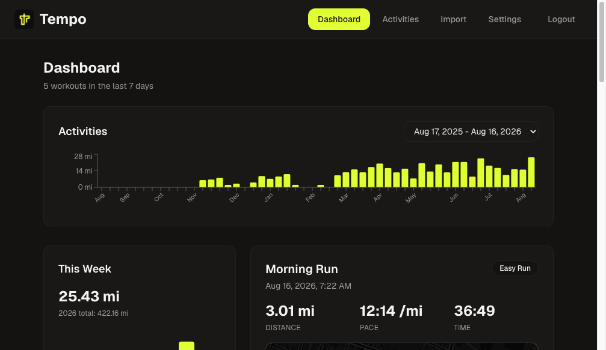
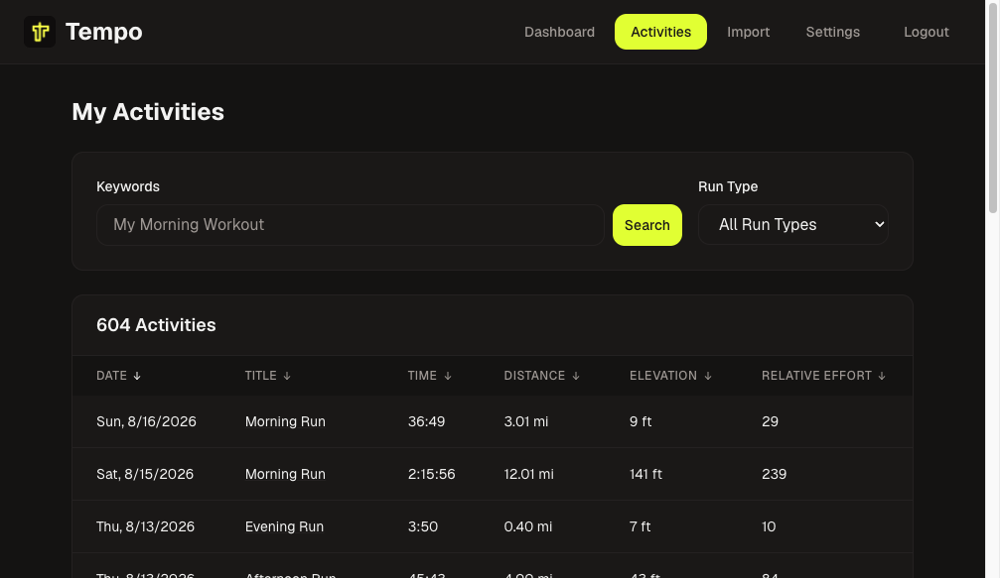
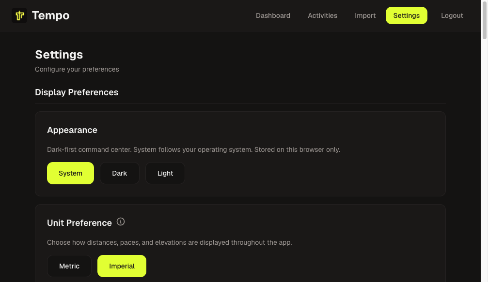

# Welcome to Tempo

> A privacy-first, self-hosted Strava alternative. Import GPX, FIT, and CSV files from Garmin, Apple Watch, Strava, and more. Keep all your data local—no subscriptions, no cloud required.


[](https://discord.gg/9Svd99npyj)

## What is Tempo?

Tempo is a self-hostable running tracker that gives you complete control over your fitness data. Unlike cloud-based services, Tempo runs entirely on your own infrastructure, ensuring your workout data stays private and secure.

## Screenshots


*Dashboard — weekly recap, relative effort, and recent workouts*


*Activities list — search, filters, and sortable columns*


*Settings — appearance and unit preferences*

## Key Features

- **Multi-Format Support** - Import GPX and FIT (.fit, .fit.gz) files from Garmin, Apple Watch, and other devices, or a whole Strava export ZIP (activities.csv + activity files)
- **Workout Analytics** - Track distance, pace, elevation, splits, and time series data
- **Workout Overview** - Map, splits, and HR/pace/elevation/cadence/power charts sharing one Highlight
- **Appearance** - System, Dark, or Light on the command center (this browser only)
- **Interactive Maps** - Themed route maps (dark/light tiles) with tokenized polylines
- **Media Support** - Attach photos and videos to workouts
- **Weather Data** - Automatic weather conditions for each workout
- **Bulk Import** - Import a Strava export ZIP as a background job (onboarding or Settings → Migrate / restore; up to 500MB)
- **First-run onboarding** - Guided setup after registration (optional Tempo restore, essentials, optional Strava)
- **Data Export** - Export all your data in a portable ZIP format for backup and migration
- **Data Import** - Restore a Tempo export as a background job under Settings → Migrate / restore with progress and cancel
- **Heart Rate Zones** - Calculate zones using Age-based, Karvonen, or Custom methods
- **Relative Effort** - Automatic calculation of workout intensity based on heart rate zones
- **Best Efforts** - Track your fastest times for standard distances (400m to Marathon) from any segment within workouts
- **Shoe Tracking** - Track mileage on your running shoes and know when to replace them
- **Workout Editing** - Crop/trim workouts and edit activity names
- **Statistics Dashboards** - Weekly and yearly statistics with relative effort tracking
- **Unit Preferences** - Switch between metric and imperial units
- **100% Local** - All data stays on your machine, no cloud sync required

## Quick Start

Get Tempo running in minutes with Docker Compose:

```bash
# Clone the repository
git clone https://github.com/trevordavies095/tempo.git
cd tempo

# Start all services
docker compose up -d

# Access the application
# Frontend: http://localhost:3000
# API: http://localhost:5001
```

That's it! The database migrations run automatically on first startup.

## Documentation Sections

### [Getting Started](getting-started/index.md)
Learn how to install and configure Tempo for your environment. Includes quick start guides, installation methods, and initial configuration.

### [User Guide](user-guide/index.md)
Complete guide for using Tempo as an end user. Learn how to import workouts, view analytics, manage media, and configure settings.

### [Developer Documentation](developers/index.md)
Technical documentation for developers. Architecture overview, local development setup, API reference, database schema, and contributing guidelines.

### [Deployment](deployment/index.md)
Production deployment guides, security best practices, backup and restore procedures, and performance optimization.

### [Troubleshooting](troubleshooting/index.md)
Common issues, solutions, and frequently asked questions to help you resolve problems quickly.

## For Developers and Agents

Start with these sources of truth, which the rest of the docs link to:

| Question | Source of truth |
|----------|-----------------|
| What does a term mean (Workout intake, Import job, Device lap, timer vs elapsed time)? | [`CONTEXT.md`](https://github.com/trevordavies095/tempo/blob/develop/CONTEXT.md) |
| How is the code organized, and where do I change X? | [Architecture](developers/architecture.md) |
| What routes exist, and what do they accept and return? | [`docs/openapi.json`](https://github.com/trevordavies095/tempo/blob/develop/docs/openapi.json), guided by the [API Reference](developers/api-reference.md) |
| What does the schema look like? | [Database Schema](developers/database.md) → `api/Data/TempoDbContext.cs` |
| Which config keys and env vars exist? | [Configuration](getting-started/configuration.md) |

## Tech Stack

- **Frontend**: Next.js 16, React 19, TypeScript, Tailwind CSS
- **Backend**: ASP.NET Core (.NET 10) Minimal APIs
- **Database**: PostgreSQL 16
- **State Management**: TanStack Query

## Support

- **Discord**: Join our community on [Discord](https://discord.gg/9Svd99npyj) for support and discussions
- **Issues**: Report bugs or request features on [GitHub Issues](https://github.com/trevordavies095/tempo/issues)
- **Changelog**: See [CHANGELOG.md](https://github.com/trevordavies095/tempo/blob/main/CHANGELOG.md) for version history and updates

## License

MIT License - see LICENSE file for details

