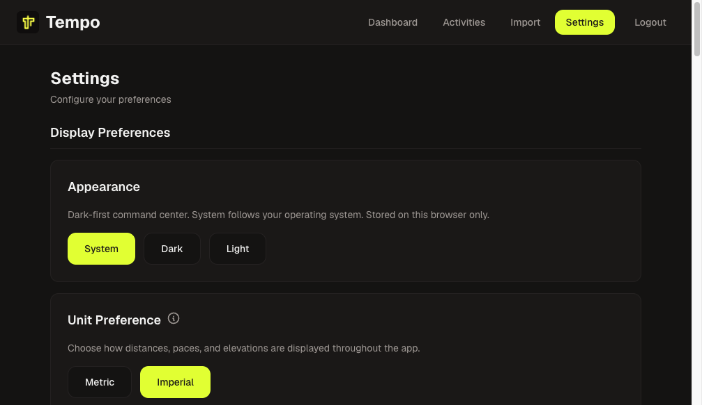

# Settings and Preferences



The Settings page, top to bottom:

| Section | Cards |
|---|---|
| Display Preferences | [Appearance](#appearance), [Unit Preference](#unit-preference) |
| Equipment Management | [Shoe Management](#shoe-management) |
| Training Configuration | [Heart Rate Zones](#heart-rate-zones), [Thresholds](#thresholds) |
| Integrations | [intervals.icu](#intervalsicu) |
| Data Management | [Export](#export-import), [Migrate / restore](#migrate--restore) |
| Data Recalculation | [Recalculate Splits, Recalculate Relative Effort](#data-recalculation) |
| Account | [Change password](#change-password), [API key](#api-key) |
| System Information | [Support snapshot](#system-information) |

Units, heart-rate zones, and an optional default shoe are usually set during [first-run onboarding](../getting-started/onboarding.md). The iOS app (daily driver) also edits units, default shoe, and shoes; everything that recalculates or is one-time setup lives here only.

**Implementation:** `frontend/app/settings/page.tsx` and the `*Section.tsx` components it imports; `api/Endpoints/SettingsEndpoints.cs`, `SettingsIntervalsIcuEndpoints.cs`, `ShoesEndpoints.cs`, `AuthEndpoints.cs`.

## Appearance

**System** (default, follows the OS), **Dark**, or **Light**. Applies immediately; no Save.

Appearance is a browser preference stored in `localStorage` as `tempo-appearance`. It is not UserSettings: not on the server, not synced to the iOS app. Maps switch tiles with it (CARTO Dark Matter / Voyager).

## Unit Preference

**Metric** (km, min/km, m, 1 km splits) or **Imperial** (mi, min/mi, ft, 1 mile splits). Click to apply; the card previews distance, pace, and elevation. The choice is saved to UserSettings and the browser.

Changing units does **not** rebuild existing splits. New imports use the current unit; run [Recalculate Splits](#data-recalculation) for older Workouts. Every import also sends the current unit and saves it.

## Shoe Management

Track mileage per pair. A shoe's **Total** is its initial mileage plus the distance of every Workout assigned to it, shown in your units.

- **+ Add New Shoe** — Brand and Model required (100 characters each), Initial Mileage optional (in your units; cannot be negative).
- **Edit** — change brand, model, or initial mileage.
- **Default Shoe** — dropdown at the top (None or any active shoe). New Workouts from any import path are assigned to it.
- **Retire** — hides the shoe from lists and the Workout shoe picker. Past Workouts keep it. Retiring the default shoe clears the default. **View retired shoes and mileage** (`/settings/shoes/retired`) lists retired pairs with **Un-retire**.
- **Delete** — removes the shoe; assigned Workouts become "None". Workouts are not deleted. Delete is command-center only.

Assign shoes per Workout on the [Workout overview](viewing-workouts.md#details-and-editors).

**Implementation:** `frontend/components/ShoeManagementSection.tsx`, `frontend/app/settings/shoes/retired/page.tsx`, `api/Endpoints/ShoesEndpoints.cs`, `api/Services/ShoeMileageService.cs`.

## Heart Rate Zones

Five zones drive time in zones and [Relative Effort](analytics.md#relative-effort). The card header shows the max HR in use and its source, plus the highest HR recorded in the last 12 months (readings above 230 bpm ignored) for comparison.

### Calculation Methods

All built-in methods use the same bands: Z1 50–60%, Z2 60–70%, Z3 70–80%, Z4 80–90%, Z5 90–100%.

| Method | Inputs | Zone boundary |
|---|---|---|
| **220 - Age** (default) | Age (1–120) | `round((220 − age) × %)` |
| **Karvonen (Heart Rate Reserve)** | Resting HR (30–120), Max HR (60–250, above resting) | `round((max − resting) × % + resting)` |
| **Custom Zones** | Min/max BPM for each of 5 zones | As entered |

Custom zones must be 30–250 BPM, each min below its max, ascending, and contiguous (each zone's max equals the next zone's min). Errors read like `Zone 2 and Zone 3 have a gap between them`.

**Zone Preview** shows the resulting BPM ranges before you save. A fresh install starts at 220 − 30.

### Saving and Recalculating

Click **Save Heart Rate Zones**. Then:

- **First save:** a dialog offers to recalculate Relative Effort for all qualifying Workouts.
- **Later saves:** **Heart Rate Zones Updated** offers **Recalculate All Workouts** (rewrites historical zone times and Relative Effort) or **Keep Existing Unchanged** (only new Workouts use the new zones).

Qualifying Workouts are those with heart-rate data (time series, FIT session average, or stored average).

**Implementation:** `api/Services/HeartRateZoneService.cs`, `api/Services/RelativeEffortService.cs`, `api/Services/WorkoutDerivations.cs`; `PUT /settings/heart-rate-zones`, `POST /settings/heart-rate-zones/update-with-recalc`.

## Thresholds

Lactate threshold **pace** (M:SS per km or mile, between 2:00 and 15:00 per km) and **heart rate** (60–230 BPM). Both optional. Click **Save Thresholds**.

Tempo stores and serves these (`GET/PUT /settings/thresholds`) for clients such as coaching tools; pace lets them classify short reps where heart rate lags. The iOS app shows them read-only. They are included in exports.

**Suggested pace:** when you have a 5K or 10K Best effort from the last 90 days, the card shows "Suggested m:ss from your 5K on <date>" with **Use this**. It is Daniels' T-pace (88% of VDOT) from that effort; when both distances qualify, the faster T-pace wins. The suggestion is never saved on its own.

**Implementation:** `frontend/components/ThresholdsSection.tsx`, `api/Services/ThresholdSuggestionService.cs`, `api/Services/DanielsVdot.cs`.

## Integrations

### intervals.icu

Optional. Tempo stores your personal intervals.icu API key and imports new running activities automatically. Not part of onboarding; privacy-minded setups can skip it and keep uploading files.

**Setup**

1. Create a free [intervals.icu](https://intervals.icu) account if you need one.
2. Connect Garmin (or another device) in intervals.icu.
3. Copy your API key from intervals.icu **Settings → Developer**.
4. In Tempo **Settings → Integrations**, paste it and click **Connect**.

Tempo probes intervals.icu before saving (`intervals.icu rejected the API key` or `Could not reach intervals.icu. Try again.` on failure). The key is stored encrypted and never shown again.

**Card:** Status, Last successful sync, Last attempt, Last error, and buttons **Sync now**, **Replace key**, **Re-enable** (when disabled), **Disconnect**.

**Sync behavior**

- Polls every 15 minutes (`IntervalsIcu__PollIntervalMinutes`). **Sync now** wakes the poller; it does not wait on the page.
- Each run lists activities from 2 days before the last successful sync (or the connection date), never more than 14 days back. Older history is a manual file or Strava ZIP import.
- Imports activities whose type is `Run` or ends in `Run`, with a FIT or GPX original file. Others are skipped.
- Each import goes through Workout intake with source `intervals_icu` and the activity id as its Workout external identity, so an activity imports once. Duplicate rules still apply against files you uploaded yourself.
- Deleting a Workout drops its identity, so the next sync can import it again.
- If intervals.icu rejects the key, sync is disabled and the key kept. Fix it in intervals.icu and click **Re-enable**, or **Replace key** (keeps sync history).
- **Disconnect** deletes the key; Workouts stay.
- Changing the server `JWT__SecretKey` makes the stored key unreadable (Last error `Could not decrypt the stored API key.`); replace the key.

**Privacy:** activity files transit intervals.icu, a donation-supported third party. Tempo does not talk to Garmin.

The connection is not in a Tempo export. Reconnect after a restore.

**Implementation:** `frontend/components/IntervalsIcuSection.tsx`, `api/Endpoints/SettingsIntervalsIcuEndpoints.cs`, `api/Services/IntervalsIcuSyncService.cs`, `IntervalsIcuSyncWorker.cs`, `IntervalsIcuSyncQueue.cs`, `IntervalsIcuClient.cs`, `SecretProtector.cs`.

## Export {#export-import}

**Export All Data** downloads `tempo-export-{timestamp}.zip`. The button reads "Exporting..." while the server builds it; large libraries take minutes.

### Export Format

```
tempo-export-{timestamp}.zip
├── manifest.json          # format version 1.0.0, Tempo version, date, counts, data paths
├── data/
│   ├── settings.json      # zones, units, thresholds, default shoe
│   ├── shoes.json
│   ├── workouts.json      # stats, name, run type, notes, RPE, source, device, raw JSON, weather, shoe
│   ├── routes.json
│   ├── splits.json        # distance splits and device laps
│   ├── time-series.json
│   └── media-metadata.json
├── workouts/{workoutId}/
│   ├── raw/{original file}
│   └── media/{mediaId}/{filename}
└── README.txt
```

Not included: Best efforts (recomputed after restore), the intervals.icu connection, Tempo API keys, the account password, and appearance.

**Implementation:** `frontend/components/ExportImportSection.tsx`, `api/Services/ExportService.cs`, `POST /workouts/export`.

## Migrate / restore {#migrate--restore}

Collapsed under the Export card (**Show**). Two uploaders:

- **Restore Tempo export** — a ZIP from **Export All Data**
- **Import Strava archive** — see [Bulk Import](bulk-import.md)

Both run as background [Import jobs](bulk-import.md#how-it-works): the ZIP (max 500 MB) uploads in 512 KiB chunks, then restores item by item. The button shows `Uploading N%...`, then `Importing processed/total...`. **Cancel import** keeps what was already restored. Refreshing Settings reattaches to an active job. Only one job runs at a time across both kinds; the other card shows `A Strava import is already in progress. Finish or cancel it before restoring a Tempo export.` (or the reverse).

### What a restore does

- **Settings** — overwrites zones, units, and thresholds. The default shoe is kept only if it exists and is not retired.
- **Shoes** — imported with their IDs. Skipped when the ID or the same Brand + Model already exists.
- **Workouts** — imported with their IDs and timestamps, plus routes, splits, time series, raw files, and media. Skipped when the ID already exists or a Workout matches on start time, distance, and elapsed time. Existing Workouts are never updated by a restore. A reference to a missing shoe is cleared with a warning.
- **Repair** — when any Workout was imported, the job runs every startup backfill (Best efforts, timer time, cadence, device laps, zone seconds, …) before reporting done, so older exports are brought up to date. Runs even after a cancel.

Exports from older versions that include `best-efforts.json` still restore; the file is ignored.

### Summary

**Import Complete!** or **Import Completed with Errors**, with imported/skipped counts for Settings, Shoes, Workouts, Routes, Splits, Time Series, and Media, plus expandable Warnings (e.g. `Workout already exists: …`, `Shoe already exists in database: …`) and Errors. Units, zones, default shoe, and thresholds refresh in the UI.

### Troubleshooting

| Symptom | Cause | Fix |
|---|---|---|
| `Import failed: manifest.json not found in export ZIP` | Not a Tempo export, or re-zipped with a parent folder | Upload the ZIP from Export as-is. |
| `Unsupported export version: X. Expected 1.0.0` | Manifest from an incompatible build | Export again from a current Tempo. |
| `File must be a ZIP file` / `File exceeds the 500MB limit` | Wrong file or over 500,000,000 bytes | Restore the database and media directory directly instead; see [Backup and Restore](../deployment/backup-restore.md). |
| Everything skipped | Restoring into the same instance | Expected; restore does not overwrite Workouts. |
| Job failed with `interrupted` | API restarted mid-restore | Re-upload; already restored items skip. |
| Best efforts missing right after restore | Repair still running on a large library | Wait for the job to report done. |

**Implementation:** `frontend/components/TempoExportImport.tsx`, `frontend/hooks/useImportJobSession.ts`, `api/Services/ImportService.cs`, `api/Services/ImportJobWorker.cs`.

## Data Recalculation

- **Recalculate Splits** — rebuilds distance splits for every Workout with a route, using the current unit preference. Device laps, distance, duration, and elevation stay. A dialog shows the Workout count first.
- **Recalculate Relative Effort** — shown once zones exist. Recomputes zone times and Relative Effort for every Workout with heart-rate data using the current zones.

**Implementation:** `api/Services/SplitRecalculationService.cs`, `POST /workouts/recalculate-splits`, `POST /workouts/recalculate-relative-effort` (and their `/count` endpoints).

## Account

### Change password

Expand **Change password**, enter the current password and the new one twice, and click **Update password**. New passwords are 16–64 characters (under 72 UTF-8 bytes); no symbol or digit rules. Other browser sessions are signed out; this one stays.

Forgot it? See [How do I reset my password?](../troubleshooting/faq.md#how-do-i-reset-my-password)

### API key

Tools such as [tempo-cli](https://github.com/trevordavies095/tempo-cli) and the Tempo extension for Claude Desktop authenticate with `Authorization: Bearer <key>`.

- **Generate key** creates your key. One active key at a time (`An active API key already exists. Revoke it before creating a new one.`).
- **Show** / **Hide** reveals the full key; **Copy** puts it on your clipboard.
- **Revoke** disables it immediately. Anything using it stops working. You can then generate a new one.

Keep it private. It can read and change your Tempo data but cannot change your password or manage API keys (those need a browser session).

If the card says the key can't be shown (`This key can't be displayed. Revoke it and generate a new one.`), it was created before reveal existed or `JWT__SecretKey` changed. It still authenticates.

API keys are not in a Tempo export. Generate a new key after a restore.

**Implementation:** `frontend/components/ApiKeySection.tsx`, `api/Services/ApiKeyService.cs`, `/auth/api-keys` in `api/Endpoints/AuthEndpoints.cs`.

## System Information

A copyable block with version, commit, logging profile, and image tags for bug reports (from `GET /version`).

## Next Steps

- [Import workouts](importing-workouts.md)
- [Understand analytics](analytics.md)
