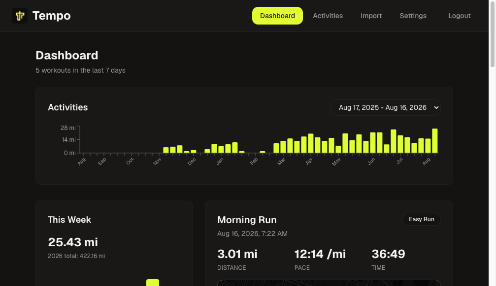
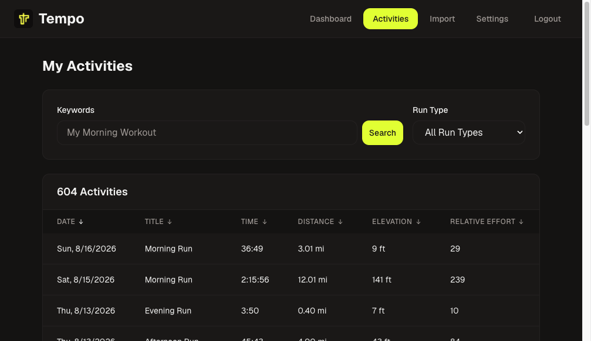

# Viewing and Managing Workouts

The navigation bar has **Dashboard**, **Activities**, **Insights**, **Import**, and **Settings**. Clicking any Workout opens its **Workout overview** (`/dashboard/{id}`).

## Dashboard

- **Activities chart** (top) — weekly distance as 52 bars over a one-year period. The selector picks the period (consecutive one-year windows back from today; default is the last 12 months). Click a bar to list that week's Workouts below; click it again to clear.
- **This Week** — the weekly recap. See [Weekly Recap](analytics.md#weekly-recap).
- **Relative Effort** — this week's cumulative Relative Effort by day against the range of the previous three weeks. See [Relative Effort](analytics.md#relative-effort).
- **Best Efforts** — fastest time per standard distance, with a recalculate button. See [Best Efforts](analytics.md#best-efforts).
- **Workout cards** — Workouts from the last 7 days (or the selected week), 20 per page. Each card shows name, date, run type badge, distance, pace, duration, and a static route map.

Card and table duration is timer time when it differs from elapsed time, otherwise elapsed. Moving time is never shown there.

**Implementation:** `frontend/app/dashboard/page.tsx`, `frontend/components/YearlyWeeklyChart.tsx`, `WeeklyRecapCard.tsx`, `RelativeEffortGraph.tsx`, `BestEffortsChart.tsx`, `WorkoutCard.tsx`; `api/Endpoints/StatsEndpoints.cs` (`/stats/yearly-weekly`, `/stats/available-periods`).

## Activities List

**My Activities** lists every Workout, 20 per page.

Filters:

- **Keywords** — case-insensitive match on name, device, or source. Press Enter or **Search**.
- **Run Type** — All Run Types, or one of the ten [run types](#run-type).
- **Date** — All Time, Last 7 Days, Last 30 Days, or Custom Range… (From / To).

Columns, each sortable by clicking the header: **Date**, **Title**, **Time**, **Distance**, **Elevation** (gain), **Relative Effort**.

**Implementation:** `frontend/app/activities/page.tsx`, `frontend/components/ActivitiesFilters.tsx`, `ActivitiesTable.tsx`, `frontend/hooks/useActivitiesFilters.ts`; `GET /workouts` in `api/Endpoints/WorkoutsEndpoints.cs` (`ListWorkouts`).

## Workout Overview

The header shows the Workout name (click to rename; up to 200 characters; empty falls back to a date-based name) and start time. The ⋮ menu has **Crop Workout** (only when the Workout has a route) and **Delete Workout**.

Tabs: **Overview**, plus **Route Comparison** when [similar runs](#similar-runs) exist.

### Highlight

Map, splits, and time-series charts share one **Highlight**: a split index and/or elapsed seconds. Hover or click a split, a chart point, or the route and the other two follow. Leaving the hover clears it.

### Details and Editors

The left card holds editable fields (click to edit, saves immediately):

- **Description** — free-text notes
- **Run Type** — None or one of the [run types](#run-type)
- **RPE (1–10)** — Rate of Perceived Exertion. Filled from the FIT session `workout_rpe` on import when present; otherwise None until you set it. Not Relative Effort.
- **Shoe** — active shoes, or None. A retired shoe already assigned is shown as "(retired)" but cannot be newly assigned (`Cannot assign a retired shoe to a workout`). Changing the shoe moves the Workout's distance between the two shoes' mileage.
- **Device** and **Source** (read-only) when known

Media upload and the gallery sit below. See [Media](media.md).

#### Run Type

Easy Run, Recovery, Walk-Run, Long Run, Workout, Threshold, Intervals, Hills, Fartlek, Race. Threshold covers tempo/threshold sessions; Workout is the generic quality session. Imports default to **Easy Run**, so treat it as "untagged or easy".

### Metrics

**Key Metrics:** Distance, Duration, Pace (average), and Relative Effort (when calculated).

Duration uses three clocks:

| Clock | Stored as | Meaning |
|---|---|---|
| Elapsed time | `DurationS` | Wall clock start to finish, pauses included. Duplicate detection and analytics sums use it. |
| Timer time | `TimerTimeS` | Time the device was running (FIT `total_timer_time`). |
| Moving time | `MovingTimeS` | Time moving by a speed threshold, when the source provides it. |

The hero **Duration** is timer time when it differs from elapsed, with `Elapsed:` underneath. Without a distinct timer time, the hero becomes **Moving Time** when it differs from elapsed. Otherwise it is elapsed.

**Additional Details** (each row only when the data exists): Elevation (gain), Elapsed Time, Moving Time (only when it differs from the hero timer time), Calories, Relative Effort, Heart Rate (max / avg bpm), time in zones Z1–Z5 with duration and percent (needs an HR series), Cadence (max / avg spm), Power (max / avg W).

**Weather:** condition with icon, Temperature, Humidity, Feels like, Wind (speed and direction), in your units.

**Implementation:** `frontend/components/WorkoutOverviewPanel.tsx`, `WorkoutOverviewEditors.tsx`, `WorkoutOverviewMetrics.tsx`, `HeartRateZoneTimeBar.tsx`, `WeatherDisplay.tsx`, `frontend/lib/workoutClocks.ts`; `PATCH /workouts/{id}` (`UpdateWorkout`).

### Splits and Laps

Columns: Split (or Lap), Distance, Duration, Pace, and Avg HR (bpm) when any split has heart rate.

When the Workout has [device laps](#device-laps), the table shows those, titled **Laps** (first column **Lap**). Otherwise it is **Splits**: 1 km (metric) or 1 mile (imperial) distance splits, the last one partial.

#### Device Laps

A device lap is a range the recording device wrote: a FIT `lap` message, or a HealthKit lap from the iOS app. They are kept when the file has 2 or more; usually auto-distance laps plus a leftover. Lap times are timer time (pauses excluded).

On structured workouts, where laps carry two or more different FIT intensities, each lap gets a tag: Warm-up, Interval, Recovery, Rest, Cool-down, or Other. Plain active laps get no tag. Workouts whose laps all share one intensity show no tags.

Changing unit preference and running **Recalculate Splits** rebuilds only distance splits; device laps are kept. Crop deletes them.

**Implementation:** `frontend/components/WorkoutDetailSplits.tsx`, `api/Services/DeviceLapMapper.cs`, `api/Services/WorkoutSplitDisplay.cs`.

### Map

- Leaflet route map with CARTO tiles: Dark Matter in Dark appearance, Voyager in Light.
- CARTO requires a free API key. Without one, tiles show an "API key required" watermark. Request a key at [carto.com/basemaps/apikey](https://carto.com/basemaps/apikey), set `CARTO_BASEMAPS_API_KEY` in your deployment `.env` (see [Configuration](../getting-started/configuration.md#carto-basemaps-maps)), restart the API, and hard-refresh the browser.
- Hovering the route sets Highlight.

### Time-Series Charts

Heart rate, Pace, Elevation, Cadence (spm), and Power (W) over elapsed time. A series with no samples is omitted; a Workout with no samples shows **No sensor data**. Stored cadence or power of `0` is not plotted. Temperature, speed, grade, and vertical speed are stored but not charted.

The command center loads up to 20,000 samples, paged from `GET /workouts/{id}/time-series`.

**Implementation:** `frontend/components/WorkoutTimeSeriesCharts.tsx`, `frontend/lib/workoutHighlight.ts`.

### Similar Runs

When other Workouts follow the same route, the overview shows a **Previous Efforts** card: the number of runs on a similar route, highlights (Best, Latest, Fastest Pace), and **View All Matches**, which opens the **Route Comparison** tab:

- **Pace Over Time** — pace of every match by date, with a linear trend
- **Quick Stats** — Best Time, Average Pace, and Trend over the last N runs
- **All Matches** — sortable by Date, Pace, or Time Difference; each row links to that Workout

Differences read from the run you are viewing: "This run −1:12 faster" (green) means it took 1:12 less than the match; "This run +0:40 slower" (red) means 0:40 more; "Same time" means equal. Pace reads the same way, e.g. "This run +0:08 /km slower". The iOS app uses the same words.

A candidate matches when all of these hold:

- It has a route and its distance is within 10% of this Workout's
- It started within 2 years before or after this Workout (no date limit when this Workout's run type is Race)
- Its start and end points are each within 100 m of this Workout's
- Sampling both routes every 100 m, the average distance between them is 50 m or less

Up to 10 matches, best match first.

**Implementation:** `frontend/components/RouteMatchesSummary.tsx`, `RouteComparisonTab.tsx`, `frontend/lib/routeDelta.ts`, `api/Services/RouteMatchingService.cs`, `GET /workouts/{id}/similar-routes`.

## Managing Workouts

### Crop

⋮ → **Crop Workout** trims time from the start and/or end (sliders or M:SS fields; at least 10 seconds must remain). Requires a route.

Crop moves the start time, rebuilds route, distance, splits, time series, and elevation from the remaining track points, deletes device laps, clears timer and moving time (pace comes from the new elapsed time), and recomputes zones, Relative Effort, and Best efforts. Device session distance from the original file is not reused.

**Implementation:** `frontend/components/CropWorkoutDialog.tsx`, `api/Services/WorkoutCropService.cs`, `POST /workouts/{id}/crop`.

### Delete

⋮ → **Delete Workout**, then confirm. Deletes the route, splits, laps, time series, media files on disk, and external identities, then returns to the Dashboard. Deleting a run synced from intervals.icu lets the next sync import it again.

### Recalculate

There is no per-Workout recalculate button. From Settings → Data Recalculation:

- **Recalculate Splits** — rebuilds distance splits for all Workouts with a route using the current unit preference. Device laps, distance, duration, and elevation are unchanged.
- **Recalculate Relative Effort** — recomputes zones and Relative Effort for all Workouts with heart-rate data.

The API also exposes `POST /workouts/{id}/recalculate-splits` and `POST /workouts/{id}/recalculate-effort` per Workout.

## Next Steps

- [Add media](media.md)
- [Understand analytics](analytics.md)
- [Configure settings](settings.md)
